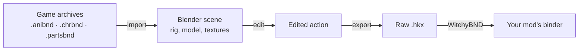

# Sekiro Animation Bridge

**Edit FromSoftware animations in Blender.** Import an HKX animation together with its skinned character, edit it like any Blender action, and export a raw HKX again. Works with Sekiro, Dark Souls (Prepare to Die and Remastered), Dark Souls III and Elden Ring.




## What it does

- **Import from game archives.** Point the bridge at a folder of the game's `.dcx` archives, pick a character and an animation, and get a Blender scene with the rig, the skinned model, textures and materials. No manual unpacking.
- **Edit in plain Blender.** The animation is a normal action on a normal armature. Constraints, drivers and NLA strips are baked on export.
- **Export to the game's own format.** Writes the HKX version the game uses, interleaved (lossless) or spline-compressed, with options for frame range, frame rate, tracks and root motion, and reads the file back to check it.
- **Retarget between characters.** The optional Blender add-on moves an animation from one skeleton to another, also when bone names differ, and exports it directly from Blender.
- **Stay local.** A small UI in an app window, served from your own computer, plus a command line for scripting. Your files never leave your PC.

## Supported games

| Game | Havok format | Checked in game |
| --- | --- | --- |
| Sekiro: Shadows Die Twice | 2016 tagfile | Interleaved export |
| Dark Souls: Prepare to Die Edition | 2010 packfile | Not yet |
| Dark Souls Remastered | 2015 tagfile | Not yet |
| Dark Souls III | 2014 packfile | Not yet |
| Elden Ring | 2018 tagfile | Not yet |

Import and export work for all five games. Every release writes and reads back synthetic animations for each of them automatically; [docs/VERIFICATION.md](docs/VERIFICATION.md) lists what was checked and how.

## Install

1. Download **`SekiroAnimationBridge-<version>-win-x64.zip`** from [Releases](../../releases) and extract it to any folder.
2. Double-click **`Start Animation Bridge.cmd`**. The first start prepares the conversion Python in `%LOCALAPPDATA%\SekiroAnimationBridge`, which needs an internet connection and takes a few minutes. Later starts open the UI right away.
3. Install [Blender 4.5](https://www.blender.org/download/lts/4-5/) if you do not have it. The bridge finds standard installations; otherwise choose `blender.exe` under **Settings & setup**.

That is all: the release includes the HKX decoder and [uv](https://github.com/astral-sh/uv), so no Python, .NET or Git installation is needed. Only the optional *Spline* export format needs the [Microsoft Visual C++ 2010 Redistributable (x86)](https://learn.microsoft.com/en-us/cpp/windows/latest-supported-vc-redist#visual-studio-2010-vc-100-sp1-no-longer-supported), which many games have already installed; **Settings & setup** shows whether it is present. To update, extract the new version and start it; your settings carry over.

For retargeting, also install **`SekiroRetargetAssistant-<version>.zip`** in Blender: *Edit › Preferences › Add-ons › Install from Disk*.

> **No game files are included.** Use archives from your own copy of the game, ideally copied outside the game folder. KRAK-compressed archives need the game's own `oo2core_6_win64.dll`; the bridge finds it in Steam libraries or asks for it.

## Quick start

1. **Import animation**: choose *Folder of DCX files*, browse to a folder with the character's archives and click **Scan folder**.
2. Pick the character and an animation, choose where to save the scene and click **Create Blender scene**.
3. Edit the animation in Blender and save.
4. **Export animation**: choose the scene, click **Read actions**, set the options and click **Export HKX animation**. You get a raw `.hkx` and a `.motion.json` sidecar.
5. Replace the animation in a copy of the game's binder with [WitchyBND](https://github.com/ividyon/WitchyBND).

## Documentation

- [User guide](docs/USER_GUIDE.md): import modes, textures, weapons, export options and the command line
- [Other FromSoftware games](docs/OTHER_GAMES.md): the files each game needs, materials and weapon placement
- [Retarget add-on](blender_addon/sekiro_retarget/README.md): bone matching, bake options and export
- [Changelog](CHANGELOG.md), [verification log](docs/VERIFICATION.md) and [credits](CREDITS.md)

## Limitations

- This is a prototype. So far only Sekiro's interleaved export has been confirmed in game.
- Skeletal transform tracks only: float tracks, additive animations and TAE events are not edited.
- The bridge writes raw HKX. Packing it into a binder is a separate WitchyBND step.
- Materials are a preview, not the game's shaders. Windows only.

## Build from source

You need Windows, Git, the [.NET 9 SDK](https://dotnet.microsoft.com/download/dotnet/9.0) and [uv](https://docs.astral.sh/uv/) (or Python 3.13).

```bat
git clone https://github.com/Greiving99/SekiroAnimationBridge.git
cd SekiroAnimationBridge
tools\setup_writer.cmd
tools\SekiroMotionDecoder\build_decoder.cmd
"Start Animation Bridge.cmd"
```

`setup_writer.cmd` creates the conversion Python; `build_decoder.cmd` builds the decoder from a pinned [SoulsAssetPipeline](https://github.com/Meowmaritus/SoulsAssetPipeline) commit. Both store their results in `%LOCALAPPDATA%\SekiroAnimationBridge`.

Run the unit tests with that Python, from the repository folder:

```bat
"%LOCALAPPDATA%\SekiroAnimationBridge\writer-env\Scripts\python.exe" -m unittest discover -s standalone/tests -p "test_*.py"
```

The Blender checks run as `blender --background --factory-startup --python standalone/tests/<script>.py`. All test fixtures are synthetic rigs owned by this project; no game files are needed.

To release, update `VERSION` and `CHANGELOG.md`, then push a tag such as `v0.6.1`. The [release workflow](.github/workflows/release.yml) builds the decoder, adds uv, starts the packaged bridge on a fresh Windows profile, runs the unit tests and publishes the ZIPs.

## Credits

Built on [Soulstruct](https://github.com/Grimrukh/soulstruct) and [Soulstruct Havok](https://github.com/Grimrukh/soulstruct-havok) by Grimrukh, [SoulsAssetPipeline](https://github.com/Meowmaritus/SoulsAssetPipeline) by Meowmaritus with [SoulsFormats](https://github.com/JKAnderson/SoulsFormats) by JKAnderson, [Blender](https://www.blender.org/), Python, NumPy, .NET and uv. [CREDITS.md](CREDITS.md) lists every component and its license.

## License

GPL-3.0-or-later; see [LICENSE](LICENSE).

Sekiro Animation Bridge is not affiliated with or endorsed by FromSoftware, its publishers, or Havok. Game names are trademarks of their owners.
