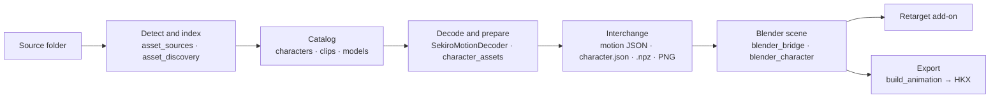

# Importing from other games: plan

**Status:** proposal. Nothing here is implemented. Written on 2026-10-29 against bridge 0.13.0 and Retarget Assistant 0.9.0. Devil May Cry 5 (DMC5) is the worked example.

## Summary

- The bridge already has a game-neutral middle: the decoder's motion JSON, and the character manifest with its `.npz` meshes and PNG textures. Blender, the skeleton preview and the retarget add-on read only those files. The Souls-specific code sits in front of them (finding, reading and decoding game files). Three hardcoded assumptions sit behind them: FromSoftware's axes, FLVER's Euler bone rotations and the list of five games.
- The plan puts every game behind one adapter interface. It splits support into an **engine family** (code) and a **game profile** (data), adds the source axes and units to the interchange files, and builds the game lists of the UI, CLI and add-on from a registry.
- After that, a second game on a supported engine is a profile plus tests. A new engine is one adapter module plus, where needed, one decoder executable. Blender scripts, the UI and the add-on do not change.
- DMC5 (RE Engine) becomes the first non-FromSoftware game. It is import-only at first: an editable scene, or a retarget donor for a Souls target that the bridge already exports. The reader is [REE-Lib](https://github.com/kagenocookie/RE-Engine-Lib) (MIT, .NET), wrapped in a second decoder executable like the existing SekiroMotionDecoder.
- Phases 0 to 2 change no behaviour for the five current games. Each ends with the existing tests passing unchanged.

## 1. How import works today



### Already game-neutral

- **Motion JSON** (`tools/SekiroMotionDecoder/Program.cs:130-149`): skeleton bones with names, parents and rest transforms; per-frame translation, rotation and scale per track; the track-to-bone map; frame rate; optional root motion. Nothing in it names Havok except the `sourceHavok` block that `bridge_runtime.py:402` adds for export.
- **Character manifest v4** (`standalone/character_assets.py:295-368`) with one `.npz` per model (`standalone/flver_geometry.py:87-97`): positions, normals, UV layers, four-bone skin weights, faces, the model's bone table, and material specs that point at PNG files.
- **Blender side**: `blender_bridge.py import` reads only `--motion-json` and `--character-manifest`. It runs in Blender's own Python without Soulstruct.
- **Retarget add-on**: bone matching works from names and rest positions, not from game IDs, and is tested on 15 rig conventions, scrambled names included (`blender_addon/sekiro_retarget/README.md`). Only the export *target* must come from the bridge (`retarget.py:135`); a donor needs no bridge metadata.
- **Donors from any source**: one import can already bring a second clip "from any source or game" (`bridge_runtime.py:443`).
- **Preview without a special decoder**: `clip_preview.computed()` (`clip_preview.py:161`) builds the skeleton preview from any motion JSON.

### Souls-specific

| Layer | Assumption | Where |
| --- | --- | --- |
| Game list | The five game IDs appear as literals in 13 files: as lists and help texts, and as `if game == ...` branches | Lists: `game_profiles.py:3`, `asset_sources.py:22`, `ui/index.html:109, 209, 298`, `ui/app.js:22-23` (help texts `:28, :36, :41`, socket hints `:786`), `sekiro_animation_cli.ps1:11, 23`, add-on `__init__.py:241`. Branches: `asset_discovery.py`, `bridge_runtime.py`, `character_assets.py`, `clip_preview.py`, `material_assets.py`, `part_animations.py`, `weapon_assets.py` |
| Detection | A game folder is one whose `chr` holds `*.anibnd*`. Executables, the MATBIN library or one small archive name the game. | `asset_sources.py:51, 65, 77`; `asset_discovery.py:180` |
| File kinds | Five kinds defined by BND, TPF and DCX suffixes | `asset_sources.py:12-20` |
| Names | Characters are `c\d{4}`, clips `a\d+_\d+.hkx`, skeletons `skeleton.hkx` | `asset_sources.py:135`; `asset_discovery.py:66, 90` |
| Matching | Clip to compendium by Havok type IDs; clip to skeleton by archive and character | `asset_discovery.py:123` |
| Selection | Wolf presets, player outfit regions, MATBIN for Elden Ring | `asset_discovery.py:567`; `game_profiles.py:74` |
| Decode | HKX header checks, decoder version handshake, four HKX input paths | `bridge_runtime.py:368-403` |
| Model | FLVER, TPF, MTD, MATBIN. The `.npz` stores FLVER Euler XZY bone rotations. | `character_assets.py:155`; `flver_geometry.py:94` |
| Axes | FromSoftware's left-handed Y-up space converts to Blender by swapping Y and Z | `blender_bridge.py:19-34`; `blender_character.py:124, 153, 207`; `ui/preview.js:3` |
| Preview | The decoder is called with the four HKX paths | `clip_preview.py:177` |
| Export | Soulstruct Havok classes per game; BND4 binders | `build_animation.py:49-60`; `game_profiles.py:66`; `binder_members.py` |
| Extras | TAE event 715 and weapon part clips (Sekiro); weapon sockets on FLVER dummies | `part_animations.py`; `weapon_assets.py`; `bridge_runtime.py:150-160` |

FromSoftware's foot-target handling (`blender_bridge.py:615`, retarget bake) is found by bone name and does nothing on rigs without those bones. It can stay as it is.

## 2. Target design

### 2.1 Rules

1. The interchange files are the only contract between adapters and Blender. Blender scripts never import adapter code; Blender's Python has neither Soulstruct nor REE-Lib.
2. An engine family owns code. A game profile owns data. A second game of a family is a new profile.
3. Capabilities decide what the UI, CLI and add-on show. No `if game == 'sekiro'` outside the adapters.
4. Every adapter passes the same contract tests with project-owned synthetic fixtures. No game files enter the repository.
5. The five current games behave exactly as now. Existing scenes, saved catalogs and preview caches keep working.

### 2.2 Package layout

```
standalone/games/
  __init__.py      registry: profiles, adapters, detect(), for_game(), ui_info()
  base.py          GameProfile, Capabilities, the GameAdapter protocol, result types
  interchange.py   axes, units and v1 defaults (standard library only, so Blender scripts can import it)
  fromsoft/        today's code behind the interface: sekiro, ds1, ds1r, ds3, er
  re_engine/       RE Engine family: dmc5 first
standalone/schemas/
  motion.schema.json  character.schema.json  preview.schema.json
tools/
  SekiroMotionDecoder/   unchanged (Havok)
  ReEngineDecoder/       new (REE-Lib)
```

Phase 1 does not need to move files. `games/fromsoft/__init__.py` can import and wrap the current modules; files can move later or never. Registry modules import no heavy library at import time (today's code already imports Soulstruct inside functions), so the UI, CLI and add-on can read profiles cheaply.

### 2.3 Game profiles

```python
@dataclass(frozen=True)
class Capabilities:
    animation: bool = True        # clip and skeleton into a scene
    model: bool = False           # skinned meshes
    textures: bool = False        # material preview images
    preview: bool = True          # skeleton preview before import
    export: bool = False          # native animation writer
    container: bool = False       # add the export to the game's archive
    weapon_parts: bool = False    # part clips paired through events (Sekiro TAE)
    weapon_sockets: bool = False  # weapon placement on model dummies

@dataclass(frozen=True)
class GameProfile:
    id: str
    name: str
    short: str
    engine: str                   # adapter that reads it
    executables: tuple            # files that identify an installation
    markers: tuple                # files or folders that identify a game or mod folder
    file_versions: dict           # extension -> version the game uses
    character_id: str             # regex of character IDs in file names
    basis: tuple                  # source axes -> Blender axes, see 2.5
    unit_scale: float             # metres per source unit
    capabilities: Capabilities
    help: dict                    # UI help texts that name this game's files

FROMSOFT_BASIS = ((1, 0, 0), (0, 0, 1), (0, 1, 0))   # swap Y and Z: today's game_to_bl_trs
RE_BASIS = ((1, 0, 0), (0, 0, -1), (0, 1, 0))        # +90 degrees about X: Y-up right-handed (inferred, 4.1)

SEKIRO = GameProfile('sekiro', 'Sekiro', 'SEK', 'fromsoft', ('sekiro.exe',), ('chr/*.anibnd*',),
    {'hkx': '20160200'}, r'c\d{4}', FROMSOFT_BASIS, 1.0,
    Capabilities(model=True, textures=True, export=True, container=True,
                 weapon_parts=True, weapon_sockets=True), help={...})

DMC5 = GameProfile('dmc5', 'Devil May Cry 5', 'DMC5', 're_engine', ('DevilMayCry5.exe',),
    ('re_chunk_000.pak', 'natives/x64'),
    {'motlist': 85, 'mot': 65, 'mesh': 1808282334, 'mdf2': 10, 'tex': 11, 'fbxskel': 3},
    r'(pl|em)\d{4}', RE_BASIS, 1.0, Capabilities(model=True, textures=True), help={...})
```

The FromSoftware profiles carry what `game_profiles.GAMES`, `SDK_GAMES`, `asset_sources.EXECUTABLES` and `game_folders()` hold today.

### 2.4 Adapter interface

```python
class GameAdapter(Protocol):
    engine: str
    profiles: tuple

    def detect(self, path) -> Detection | None: ...                # game, layout, evidence, confidence
    def index(self, source, cache, notify) -> Catalog: ...         # characters by file name
    def inventory(self, catalog, character, cache, notify) -> Catalog: ...  # one character's clips
    def select(self, catalog, clip_id, options) -> Selection: ...  # inputs plus default model and textures
    def decode(self, selection, work, notify) -> Path: ...         # motion JSON v2
    def preview(self, selection, cache) -> bytes | None: ...       # None: computed from decode()
    def prepare_character(self, selection, work, notify) -> Path | None: ...  # manifest v5
    def extras(self, selection, manifest, work, notify) -> dict: ...  # optional
    def write(self, motion, output, options) -> dict: ...          # only with capabilities.export
```

| Method | FromSoftware today | DMC5 |
| --- | --- | --- |
| `detect` | `asset_sources.detect`, `executable_game`, `material_game`, `probe_game` | `DevilMayCry5.exe`, `re_chunk_000.pak`, a `natives/x64` folder |
| `index` | `asset_discovery.index_source`, `discover_folder` | `animation/{player,enemy}/<id>/` folders |
| `inventory` | `inventory_character`, `match_clips` | read each motlist's clip list |
| `select` | `selection()` | skeleton source; body, head and hair meshes; materials |
| `decode` | `bridge_runtime.py:368-403` and SekiroMotionDecoder | ReEngineDecoder `decode` |
| `preview` | `clip_preview.preview` | default: computed from the motion JSON |
| `prepare_character` | `character_assets.prepare_character` | ReEngineDecoder `mesh`, `mdf2`, `tex`, packed into `.npz` |
| `extras` | `part_clips`, `weapon_places` | none |
| `write` | `build_animation.build`, `binder_members` | none in the first version |

The registry asks every adapter in `detect()` and keeps the strongest evidence (executable, then markers, then a probe), with the evidence text the UI shows today. `for_game(id)` returns the profile and adapter. `ui_info()` returns the JSON for a new `/api/games` route.

`bridge_runtime.convert()` then reads: `select`, `decode`, `prepare_character`, `extras`, then the unchanged Blender import. Export calls `write` when the scene's game has `export`; otherwise it stops with "this game is import-only".

**Catalog schema 4** adds a top-level `adapter` and, per clip, an `inputs` object that only the adapter reads (FromSoftware: `animation`, `skeleton`, `compendium`, `skeletonCompendium`; DMC5: `motlist`, `motIndex`, `skeletonSource`). The UI keeps reading `id`, `name`, `archive`, `member`, `character`, `characterKey`, `game`, `ready` and `issues`. Schema 3 catalogs keep loading, read as `adapter='fromsoft'`, instead of forcing a rescan; `load_catalog` (`asset_discovery.py:543`) accepts only schemas 2 and 3 today and needs that addition.

### 2.5 Interchange v2

Motion JSON v2 adds three fields. Everything else stays as in v1.

```jsonc
{
  "format": "sekiro-animation-bridge",
  "formatVersion": 2,
  "source": {"game": "dmc5", "engine": "re_engine", "container": "motlist", "version": 85,
             "archive": ".../pl0100_basic.motlist.85", "member": "<mot name>"},
  "basis": [[1, 0, 0], [0, 0, -1], [0, 1, 0]],
  "unitScale": 1.0
  // unchanged: clip, skeletonName, skeleton, frameCount, frameRate, duration, trackCount,
  // trackBoneIndices, trackNames, rootMotion, rootUp, rootForward, frames
}
```

A v1 document, including the source text embedded in every existing `.blend`, reads as `FROMSOFT_BASIS` and unit scale 1. `game` and `sourceHavok` stay for FromSoftware export.

**One conversion for every game.** `basis` is a signed permutation matrix B from source axes to Blender axes; s is `unitScale`.

- translation: `s · B·t`
- scale: `|B|·scale` (axes permuted, no sign)
- rotation: `(x, y, z)` becomes `det(B) · B·(x, y, z)`; `w` stays

With `FROMSOFT_BASIS` this gives exactly today's `game_to_bl_trs` (`blender_bridge.py:19-26`); this was checked numerically for 2,000 random rotations while writing this plan and becomes a unit test. With `RE_BASIS` it equals the rotation matrix conjugated by B. Export applies the inverse. `interchange.py` uses only the standard library, so the Blender scripts can import it the way `blender_bridge.py` imports `blender_character.py`.

**Character manifest v5** adds `basis`, `unitScale` and `boneRotation`: `euler_xzy` (FLVER, today) or `quaternion`, which reads a new `bone_quaternions` array (x, y, z, w) from the `.npz`. A material's `normal` gains `convention` (`directx` or `opengl`) and `channels` (`rgb`, or `rg` with blue rebuilt). Version 4 manifests read with today's defaults.

**Preview JSON** gains an optional `basis` that `ui/preview.js` applies instead of its fixed Y-up assumption. A missing `basis` means FromSoftware, so cached previews stay valid.

**Blender metadata** keeps the `sekiro_*` and `hkx_*` custom property names. Saved scenes and the add-on depend on them, and renaming gains nothing. The docs define `hkx_track_index` as "source track index" for every game. Capability checks read `source.game` from the embedded motion.

### 2.6 Native decoders

- One executable per engine family, called as a subprocess like SekiroMotionDecoder (`bridge_runtime.run`). `--version` lists capability words; `bridge_runtime.py:385-391` already gates on such words, and **Settings & setup** shows each decoder's status.
- Each pins its library to a commit, has its own `build_*.ps1`, and is built by the release workflow, as `build_decoder.ps1` does for SoulsAssetPipeline today.
- Separate executables keep the two dependency trees, licences and release cadences apart.
- Output: motion JSON v2 directly. Meshes come out as a JSON header plus binary buffers; the Python adapter packs them into the same `.npz` layout, so `blender_character.py` reads one format.

### 2.7 UI, CLI and add-on from the registry

- `/api/games` returns each game's ID, name, short name, engine, capabilities, help texts and socket hints. `app.js` builds `gameNames`, `gameShort`, `socketHints` and the three game selects from it; `index.html` keeps only the *Auto* options.
- Panels follow capabilities: weapon placement and part clips (`weapon_parts`, `weapon_sockets`), **Textures & materials** (`textures`), **Also add it to an animation binder** (`container`). The export page says "import-only: retarget onto a scene from a game with export" when the scene's game lacks `export`.
- CLI: `-Game` and `-DonorGame` become plain strings with an argument completer; Python validates them against the registry and lists the supported games in the error.
- Add-on: the export-game list comes from a `games.json` that `remember_location()` (`bridge_runtime.py:529`) writes beside `bridge-location.json`, with today's five as fallback. **Export HKX** is disabled, with the reason, for an import-only target.
- `build_animation.py --game` offers the games that have a writer.

## 3. Adding a game after the refactor

| Step | Same engine (e.g. RE2 after DMC5) | New engine |
| --- | --- | --- |
| 1. Profile: names, executables, markers, file versions, ID pattern, axes, units, capabilities, help texts | yes | yes |
| 2. Adapter module | no | yes |
| 3. Decoder executable | no, or a capability word | if no Python reader exists |
| 4. Stand-in fixtures: empty files with the game's names, like `GAME_FILES` in `tests/test_sources.py` | yes | yes |
| 5. Synthetic content fixtures (clips and meshes the project writes itself) | reuse | yes |
| 6. `docs/games/<id>.md`, a README table row, CREDITS for new libraries, VERIFICATION.md evidence | yes | yes |

New contract tests in `standalone/tests/test_adapters.py` run for every registered game:

1. `detect` on a stand-in tree returns the game and layout.
2. `index` and `inventory` list the expected characters and clips.
3. `select` resolves the inputs and default model parts.
4. `decode` output validates against `motion.schema.json`, and known transforms survive within tolerance.
5. `prepare_character` output validates against `character.schema.json`.
6. A Blender test (`blender_adapter_roundtrip.py`) imports a synthetic decode and samples it back to the source values, which proves the axes and units.
7. No capability is claimed without an implementation.

## 4. Worked example: Devil May Cry 5

### 4.1 DMC5's files

*Checked* means read from the cited source on 2026-10-29. *Inferred* means it must be confirmed on real files in Phase 4.

| Item | DMC5 | Evidence |
| --- | --- | --- |
| Installation | `DevilMayCry5.exe`, `re_chunk_000.pak` and its patch PAKs (patch 001 and later) | Checked: Nexus Mods guide |
| Paths | All 70,771 listed paths start with `natives/x64/` | Checked: REE.PAK.Tool's DMC5 path list |
| File versions | motlist 85, mot 65, mesh 1808282334, tex 11, mdf2 10, fbxskel 3, motbank 1, jmap 10 | Checked: REE-Lib-Resources `dmc5/file_extensions.json`; REE-Lib `MotVersion.RE2_DMC5 = 65`, `MotlistVersion.RE2_DMC5 = 85` |
| Animations | `natives/x64/animation/player/pl0100/motlist/pl0100_basic.motlist.85`; 2,759 motlists, plus 748 loose `.mot.65` files such as `animation/enemy/em0000/fbx/em0000_idle_01.mot.65` | Checked: path list |
| Models | `natives/x64/character/player/pl0100_dante/pl0100_body/pl0100.mesh.1808282334`, with head `pl0100_01` and hair `pl0100_03`; costume (`_c00_`), Devil Trigger (`majin`) and damaged (`dirt`) variants in sibling folders | Checked: path list |
| Skeleton | Each version 65 mot carries its own bone list with names, parents and rest translation and rotation (shared bone lists start with RE3). Meshes carry bones. 16 `.fbxskel.3` files, mostly player bodies and heads. | Checked: REE-Lib `MotFile.cs` (`HasSharedBoneList`), path list |
| Character IDs | pl0000 Nero, pl0100 Dante, pl0200 V, pl0300 Vergil, pl0400 Nico, pl0500 Lady, pl0600 Trish, pl0800 playable Vergil (`vergilpl`); 47 enemy folders starting with `em`. Display names come from the folder names. | Checked: path list |
| Axes | Y-up, right-handed: Blender needs +90° about X | Inferred: RE Mesh Editor's importer converts with a ±90° rotation about X |
| Units | Metres | Inferred: no unit scale found in RE Mesh Editor's importer |
| Readers | REE-Lib: MIT, .NET 8, active (last push 2026-10-25); has readers for mot, motlist, mesh, mdf2, tex, fbxskel and PAKs, with DMC5 compression tables (its readme says some formats are incomplete). RevilLib: GPL-3.0, C++, motlist 85 and mot 65. RE Mesh Editor: GPL-3.0, archived. | Checked: repositories |

### 4.2 Concepts side by side

| Bridge concept | FromSoftware | DMC5 |
| --- | --- | --- |
| Installation | `sekiro.exe` beside `chr/` | `DevilMayCry5.exe` beside `re_chunk_000.pak` |
| Container | DCX, BND4 | PAK plus patch PAKs, paths stored as hashes |
| Character ID | c5060 | pl0100, em0000 |
| Animation archive | `c5060.anibnd.dcx` | `animation/player/pl0100/motlist/*.motlist.85` |
| Clip | a member such as `a000_003041.hkx` | one mot in a motlist, or a loose `.mot.65` |
| Skeleton | `skeleton.hkx` with its compendium | body mesh, `.fbxskel.3`, or the mot's own bone list |
| Model | FLVER in a CHRBND or PARTSBND | `.mesh.1808282334` files in `character/player/pl0100_dante/` |
| Outfit parts | `hd`, `bd`, `am`, `lg` PARTSBNDs | body, head and hair meshes; costume and Devil Trigger variants |
| Materials | MTD, MATBIN | `.mdf2.10` beside each mesh |
| Textures | TPF, TEXBND | `.tex.11` |
| Events | TAE | motlist clips and timelines (not read) |

### 4.3 Source layouts

1. **Extracted `natives` folder** (first). The user extracts with an existing tool (REtool, Fluffy Mod Manager or REE.PAK.Tool) and chooses the folder that holds `natives`. No path list is needed. Mod files in `natives/x64/...` hide the game's files of the same path, the way an earlier folder hides a later one today (`asset_sources.py:106`).
2. **Game folder** (second). The bridge reads `re_chunk_000.pak` and its patch PAKs through REE-Lib's `PakReader`, which needs a list of paths for the stored hashes. The community DMC5 list has no licence, so the bridge does not ship it: **Settings & setup** asks for the file, or downloads it after the user agrees. Indexing uses only paths. A character's files are extracted into the asset cache when the character is chosen, as `inventory_character` reads archives today, and `cache_cleanup.py` limits them.
3. **Collected folder.** Loose `.motlist.85` and `.mesh.1808282334` files anywhere, grouped by the ID in their names.

### 4.4 Catalog and selection

- **Characters** come from `animation/player/<id>/` and `animation/enemy/<id>/`. The name comes from the character folder (`pl0100_dante` gives Dante); the list shows "DMC5 · PL0100 · Dante".
- **Clips**: one per mot in each motlist, plus loose `.mot.65` files. The clip ID hashes the motlist path and mot index, because mot names repeat. Mirrored entries (motlist `Mirror` flag, which needs a joint map) and additive clips are listed with an issue and are not ready, as additive HKX clips are today. Partial-body clips need nothing special: untracked bones keep their rest pose.
- **Skeleton**: the matching body mesh first, because it has every bone the model weights; then `.fbxskel.3`; then the mot's own bone list. Tracks are matched to bones by name. Bones are reordered parents first, which `blender_bridge.import_motion` requires (`blender_bridge.py:97`). Bones the model weights but the clip's skeleton lacks are added by `ensure_model_bones` (`blender_character.py:111`) once it reads quaternions (Phase 2).
- **Models**: animation ID pl0100 matches the folders `pl0100_dante`, `pl0100_c00_dante`, `pl0110_dante_majin` and so on. The default is the base folder's body, first head and first hair; the rest stay selectable, like Souls player outfits (`game_profiles.player_parts`).
- **Materials and textures**: mdf2 texture slots map to albedo, normal and emissive through a DMC5 slot table filled from real files. Textures go from tex to DDS (REE-Lib `TexFile.ConvertToDDS`) to PNG. An unknown slot leaves the material neutral, as today.

### 4.5 Decoding a mot

- `ReEngineDecoder decode <motlist> <index> <skeleton source> <out.json>` reads the mot with REE-Lib's `MotFile`, which has DMC5's own compression tables (`TranslationDictDmc5`, `RotationDictDmc5`).
- It samples the stored keys at every frame of the clip's rate: linear for translation and scale, normalised quaternion interpolation with sign continuity for rotation. Bones without tracks keep their rest pose.
- Root motion stays on the root bone's track and `rootMotion` is null. A Souls target can still get root motion on export with the existing **Root motion › Extract from a bone's travel**.
- The output is motion JSON v2 with `RE_BASIS`, unit scale 1 and a `source` block. A `preview` subcommand is optional; without it, `clip_preview.computed()` builds the preview.

### 4.6 What the user does

1. **Add a source** and choose the DMC5 folder. The bridge shows "Game folder · Devil May Cry 5" or "Extracted folder · Devil May Cry 5".
2. Pick Dante. The motlists list their clips, and the skeleton preview plays the chosen one.
3. The model fills in with body, head and hair. **Textures & materials** shows what was found.
4. Click **Create Blender scene**. The export page explains that DMC5 is import-only.
5. To put the motion on a Sekiro character: on **Import animation**, choose the Sekiro clip as the target and the DMC5 clip as the retarget donor (one import brings both characters). Then bake with the add-on and click **Export HKX**, as for two Souls characters today.

### 4.7 Not in the first DMC5 version

- Writing mot files or rebuilding motlists. This needs an encoder, a motlist rebuild and in-game testing; decide after import works.
- Mirrored clips (joint maps), additive layers, facial blend shapes, hair and coat chain physics, events and timelines.

### 4.8 Already possible by hand

The donor needs no bridge metadata. In principle, a DMC5 clip exported to FBX through Noesis with the fmt_RE_MESH plugin can be imported with Blender's FBX importer and baked onto a Souls target today; this was not tried. It takes several tools and manual axis and scale settings, so it is a stopgap, not the goal.

## 5. Roadmap

Sizes are rough: S is about a day, M several days, L one to two weeks of focused work.

| Phase | Work | Size | Done when |
| --- | --- | --- | --- |
| 0. Specify | `docs/INTERCHANGE.md`; schemas for motion v1, manifest v4 and preview JSON; tests validate today's outputs | S | Schemas pass on synthetic outputs; no code path changes |
| 1. Registry | `games/` package; FromSoftware adapter wrapping today's functions; `bridge_runtime`, `clip_preview` and `build_animation` go through the registry; `/api/games`; data-driven selects, CLI and add-on list | M | Every unit and Blender test passes unchanged; the UI looks the same |
| 2. Interchange v2 | `basis`, `unitScale`, `boneRotation`, normal conventions; Blender scripts, `preview.js` and export use them; capability gating | M | FromSoftware numbers identical; synthetic round trip with `RE_BASIS` passes; old scenes export as before |
| 3. ReEngineDecoder | C# tool on a pinned REE-Lib: `--version`, `motlist`, `decode`, `mesh`, `mdf2`, `tex`, `pak-list`, `pak-extract`; build script; release workflow; CREDITS | M-L | Decodes synthetic mot and mesh files written by REE-Lib with known values |
| 4. DMC5 adapter | Extracted layout, then game folder; catalog, selection, character, textures, help texts, `docs/games/dmc5.md` | L | Contract tests pass. With the user's own files: Dante's idle imports, the skin follows the rig, the left side lands on Blender +X, the height is plausible. Recorded in VERIFICATION.md. |
| 5. Retarget check | DMC5 donor onto a Sekiro target; an RE Engine naming convention in `tests/humanoids.py`; mapping words if needed | M | Core bones match in the test; the exported HKX reads back |
| 6. Second RE game | RE2 profile: same mot 65 and motlist 85 as DMC5, mesh 1808312334, tex 10 | S | Contract tests only, which shows the convenience goal |
| 7. Optional | DMC5 export | L+ | Separate decision |

Phase 2 comes before any DMC5 code, so the Blender side is proven with a synthetic non-FromSoftware basis before real DMC5 data arrives.

## 6. Risks and open questions

- **RE Engine axes and units are inferred.** The first real import checks that a left-side bone ends at Blender +X (the convention of `tests/humanoids.py`), the character stands along +Z, and the height is plausible. If one is wrong, the profile's `basis` or `unit_scale` changes, not code.
- **Mot decoding.** REE-Lib marks its DMC5 structures as verified. A few clips are still compared against a second reader (the Noesis plugin or RevilLib).
- **Skeleton details.** RE skeletons may not be in parent-first order and may repeat names; the adapter reorders and reports duplicates. A mot's bone list can lack bones the mesh weights; `ensure_model_bones` covers that after Phase 2.
- **PAK path list.** It is unlicensed and can drift with game patches; unmatched hashes leave files unnamed. The extracted layout comes first for that reason.
- **Disk use.** Extracted characters live in the asset cache; `cache_cleanup.py` limits apply.
- **Textures and materials.** Formats such as BC7 and the DMC5 slot names are filled in from real files. Unknown slots stay neutral, as today.
- **Library drift.** REE-Lib is active; the decoder pins a commit and upgrades only with its tests. RE Mesh Editor is archived and is not a dependency.
- **Retarget quality.** DMC5's stances and Devil Trigger skeleton variants are untested. The add-on's weapon features expect FromSoftware weapon bones and may not apply to DMC5 donors.

### Alternatives considered

- **Port mot decompression to Python** (REE-Lib or RevilLib as reference). No second .NET tool, but thousands of lines to own and keep current. Not now.
- **Only generic FBX or glTF import.** Fast to add, but manual and lossy, and not convenient for a non-expert. It stays as the stopgap in 4.8.
- **Run-time plugins from a user folder.** Not needed while every adapter lives in this repository. Entry-point discovery can be added later without changing the interface.

## 7. Licences

- The bridge is GPL-3.0-or-later.
- REE-Lib (MIT) can be built into ReEngineDecoder and shipped, credited in CREDITS.md.
- REE-Lib-Resources (MIT): its DMC5 file-version table can be copied with credit.
- RevilLib (GPL-3.0) is compatible as a reference or alternative. RE Mesh Editor (GPL-3.0, archived) is a reference only.
- REE.PAK.Tool's path list has no licence and is not shipped.
- No game files in fixtures. DMC5 tests use stand-in files and synthetic data that REE-Lib writes in the decoder's test mode.

## Sources

- [REE-Lib (RE-Engine-Lib)](https://github.com/kagenocookie/RE-Engine-Lib): `REE-Lib/RszFile/MotFile.cs`, `MotlistFile.cs`, `OtherFiles/MeshFile.cs`, `TexFile.cs`, `Pak/PakReader.cs`
- [REE-Lib-Resources](https://github.com/kagenocookie/REE-Lib-Resources): `dmc5/file_extensions.json`, `resource-info.json`
- [REE.PAK.Tool](https://github.com/Ekey/REE.PAK.Tool): `Projects/DMC5_STM_Release.list`
- [RevilLib](https://github.com/PredatorCZ/RevilLib): supported RE Engine motlist and motion versions
- [RE Mesh Editor](https://github.com/NSACloud/RE-Mesh-Editor): `modules/mesh/blender_re_mesh.py`, axis rotation on import
- [fmt_RE_MESH Noesis plugin](https://github.com/SilverEzredes/fmt_RE_MESH-Noesis-Plugin_SILVER): mesh and motlist import in Noesis
- [Nexus Mods DMC5 guide](https://www.nexusmods.com/devilmaycry5/articles/161): installation files and PAK extraction
